<div align="center">

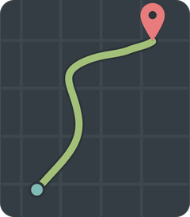

# OxRide

**Right route. Right time.**

Cycle navigation for Oxford that picks the best route for the hour you ride,<br>
and that you talk to instead of tapping.

[](https://oxfordride.vercel.app)
[](https://drive.google.com/file/d/1Mv7RjkTfA6bIRbR0u-mDRknn6hZ7KVaR/view)
[](#team)
[](https://github.com/OrionSilverStorm/OxRide/actions/workflows/tests.yml)

<a href="https://drive.google.com/file/d/1Mv7RjkTfA6bIRbR0u-mDRknn6hZ7KVaR/view">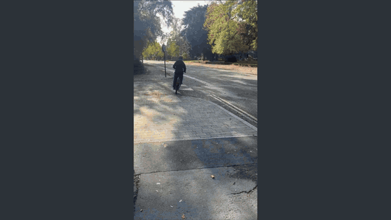</a>

<sub>The demo at double speed. <a href="https://drive.google.com/file/d/1Mv7RjkTfA6bIRbR0u-mDRknn6hZ7KVaR/view">Watch the full 55-second video with sound</a>, or <a href="https://drive.google.com/file/d/1Kg7IuTk3nGNrHDpfCL37EvraNJMN10Jf/view">the raw handlebar footage</a>.</sub>

</div>

---

## Why OxRide

Google Maps gives cyclists the shortest route. In Oxford that is often a busy main road: traffic, red lights, constant stopping, and not much faster in the end. OxRide plans for the time you actually ride:

- **After dark** it prefers lit streets.
- **At rush hour** it keeps you off main roads.
- **When rain is forecast** it avoids gravel and dirt paths.
- **Always** it weighs hills, surface and road type.
- **If you go off route** it notices and replans from where you are.

You can't type on a bike, so you talk to it. Gemini listens to what you say and works out what you want; ElevenLabs speaks the answer and every turn.

<table>
  <tr>
    <td align="center">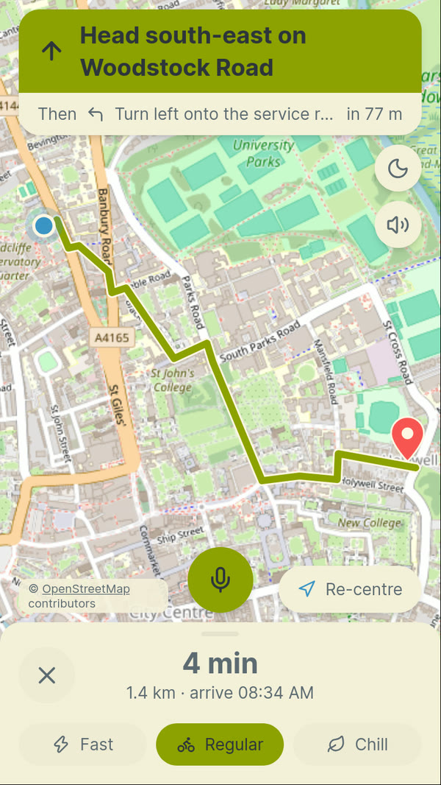<br><sub>Navigating by day: this turn, then the next</sub></td>
    <td align="center">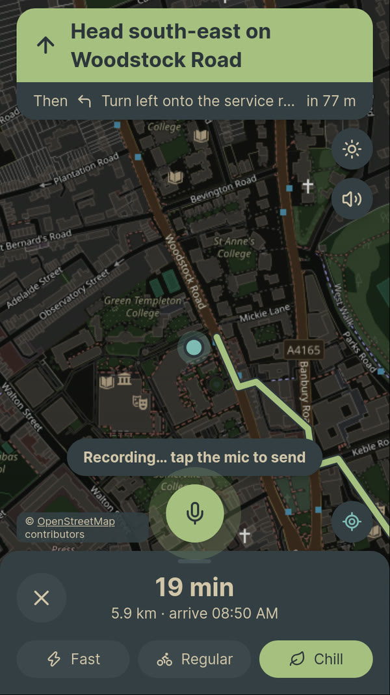<br><sub>Night theme, recording a voice command</sub></td>
    <td align="center">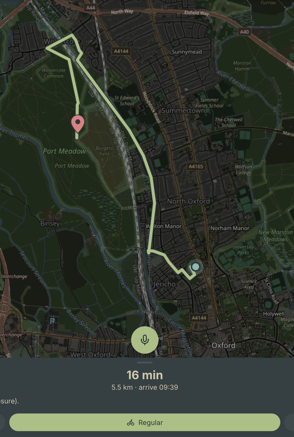<br><sub>A Regular ride to Port Meadow, 5.5 km</sub></td>
  </tr>
</table>

## What it does

| | |
| --- | --- |
| **Routes that follow the clock** | Our own A* search on Oxford's bike network. Every road's cost changes with darkness, rush hour, rain and hills, so the same trip gives a different route at 22:00 than at noon. |
| **Three ride types** | **Fast** stays close to the quickest route. **Regular** prefers cycle paths and avoids repeated climbs. **Chill** takes cycle paths and quiet roads even if they are longer. Switch any time, even mid-ride. |
| **Talk to it** | Hold the mic and speak, or tap to start and tap again to send. *"Chill ride to the Rad Cam"*, *"find me a quieter way"*, *"how long left?"* Gemini hears the recording itself and knows Oxford's nicknames. |
| **Spoken directions** | Each new instruction is read out by ElevenLabs, with street names and roundabout exits. Mute silences it; pressing the mic interrupts it. If ElevenLabs is unavailable, the phone's own voice takes over. |
| **When to leave** | One line under the route when waiting is worth it: *"Rain from about 14:00. Leave now to arrive dry."* |
| **Honest ETAs** | Ride time from gradient, surface, road type and wind, using speed effects measured on 2.2 million real trips. Streets with enough real OxRide rides use the speed people actually ride there. |
| **Learns from rides** | Every ride is logged anonymously to Tiger Data. On arrival you see predicted vs actual time. If several riders turn away from the same street, OxRide flags a possible closure and routes around it. |
| **Built for a bike** | Live GPS, a route line that shrinks as you ride, automatic rerouting, a map you can drag and re-centre, light and dark Everforest themes (always dark while navigating). |

## How time changes the route

Every road segment gets a cost: its length, scaled by how much your ride type likes that kind of road and surface, plus a charge for climbing, all multiplied by what the time of day does to it.

| When | What gets more expensive | By |
| --- | --- | --- |
| After dark | Streets with no lighting (unknown lighting: ×1.2) | ×1.6 |
| Weekday rush hour, 07:30 to 09:30 and 16:30 to 18:30 | Trunk, primary and secondary roads | ×1.5 |
| Rain in the forecast | Gravel, dirt and grass paths | ×1.4 |
| 3+ riders turned away from a street in the last 2 hours | That street | ×5 |
| Riding into the wind | Every segment, a little (wind mainly changes the ETA) | up to ×1.014 |

**Example:** from Osney to the Iffley Road sports centre on the Regular ride type, 36% of the daytime route is lit. Plan the same trip at night and 97% of the route changes, to one that is 93% lit.

### Ride types

| | Fast | Regular | Chill |
| --- | --- | --- | --- |
| Cycle path | ×1.0 | ×0.7 | ×0.5 |
| Residential street | ×1.0 | ×1.0 | ×0.8 |
| Primary road | ×1.0 | ×2.5 | ×5.0 |
| Ring road (trunk) | ×2.0 | ×4.0 | ×8.0 |
| Gravel | ×1.23 | ×1.5 | ×1.3 |
| Each metre climbed counts as | 4 m of flat riding | 15 m | 25 m |

Fast's surface and hill numbers come straight from the measured slowdowns (gravel is 19% slower, so ×1/0.81 = ×1.23). Below 1 makes a road look shorter to the search, above 1 makes it look longer.

### Results

Ten fixed Oxford trips, calm daytime weather (`python backend/benchmark.py`):

| Route | Distance | Time | On main roads | On cycle paths |
| --- | --- | --- | --- | --- |
| Shortest distance | 3.70 km | 11.3 min | 44% | 20% |
| **OxRide Regular** | 4.39 km | 13.2 min | **4%** | **52%** |
| OxRide Chill | 4.57 km | 13.8 min | 2% | 52% |

For an average of 1.9 extra minutes, the Regular route spends a tenth as much of the ride on main roads and two and a half times as much on cycle paths.

## The data behind the ETA

The speed model comes from the *Bicycle Driving Behaviour in Germany* dataset: cycling GPS trips from 100 cities.

- We started with about **2.7 million trips** and linked each to map and weather data.
- We removed the unreliable ones: non-everyday riding, trips under 2 minutes or over 2 hours, under 0.5 km or over 30 km, impossible speeds and round trips. That left **2.21 million A-to-B trips**.
- Comparing the **same rider in the same weather** separates the effect of gradient, surface and road type. The raw comparison is misleading: on a 4%+ climb riders look 30% slower, but the same rider in the same conditions is **16% slower**.
- Rain makes **no measurable difference** to speed, so in OxRide rain changes the route (avoid gravel) but not the ETA.

<table>
  <tr>
    <td align="center" width="50%">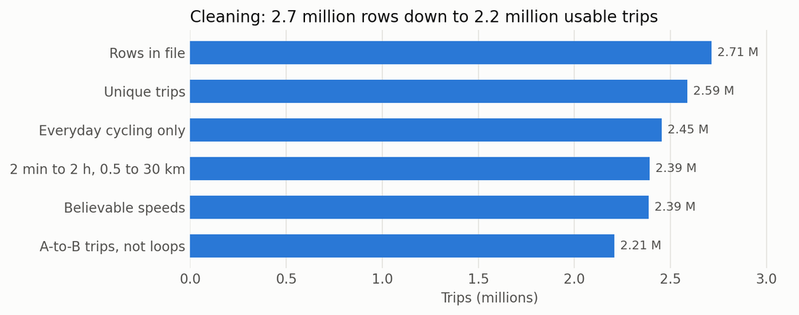<br><sub>2.7 million trips in, 2.21 million clean A-to-B trips out</sub></td>
    <td align="center" width="50%">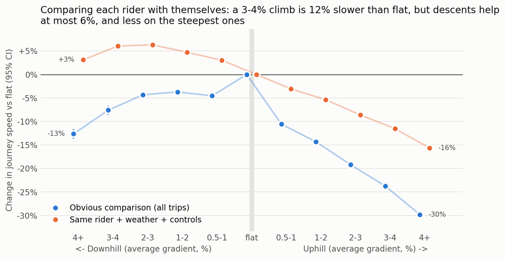<br><sub>Hills: the obvious comparison vs the same rider with controls</sub></td>
  </tr>
  <tr>
    <td align="center" width="50%">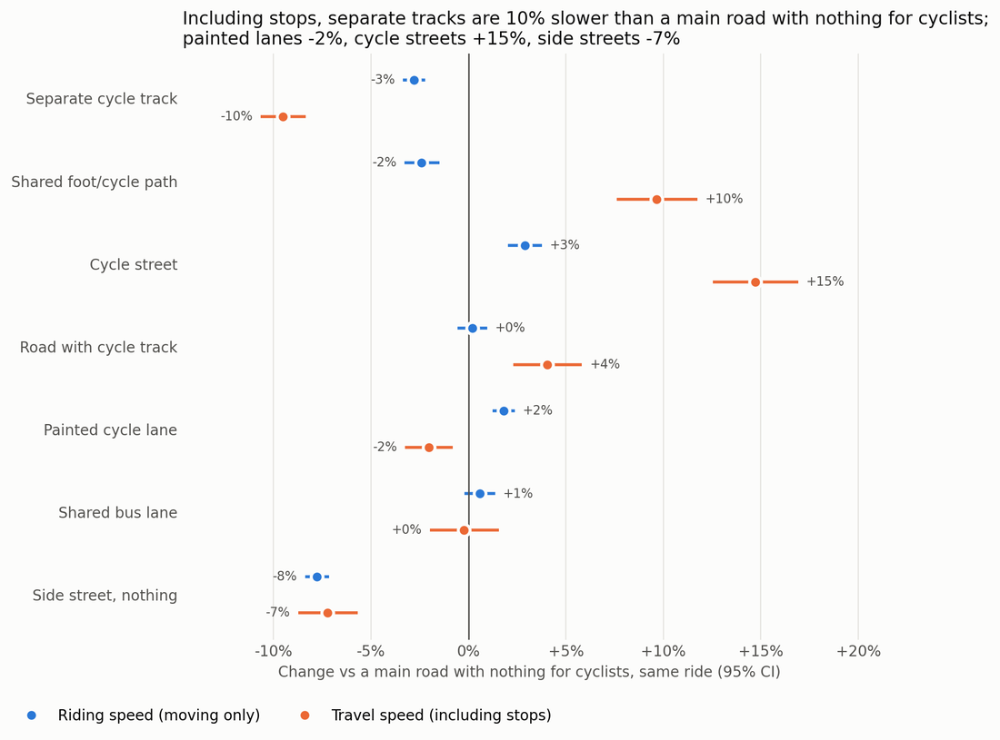<br><sub>Cycle infrastructure mostly saves time by cutting stops</sub></td>
    <td align="center" width="50%">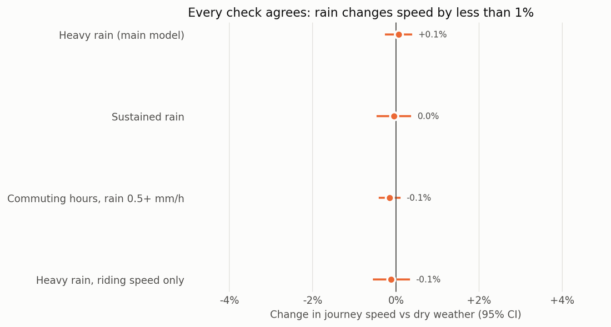<br><sub>Rain: within ±0.1% of dry weather</sub></td>
  </tr>
</table>

**The speed model.** A base of 15 mph on flat asphalt with no wind, multiplied by banded effects, plus 2 s per junction:

| Effect | Change in speed |
| --- | --- |
| Uphill 0.5% / 1% / 2% / 3% / 4%+ | −3% / −5% / −8% / −12% / −16% |
| Downhill 0.5% / 1% / 2%+ | +3% / +5% / +6% |
| Surface | gravel −19%, cobbles −5% |
| Wind along the road, 6+ m/s | headwind −1.4%, tailwind +1.7% |

Where Tiger Data has 6 or more real GPS points on a street around that hour of the day, the ETA uses the speed riders actually did there instead, and the app says "from real rides".

## How it works

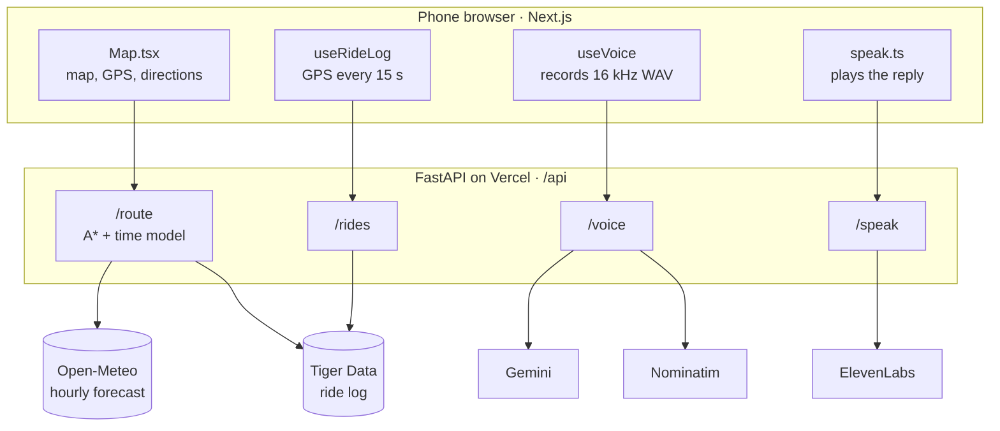

One Vercel project runs both halves: `/api/*` goes to the Python backend, everything else to the Next.js app. API keys live only on the backend.

<details>
<summary><b>Routing: our own A*</b></summary>

<br>

The map is Oxford's bike network from OpenStreetMap (9,705 junctions, 22,516 one-way road segments), with the height of every junction from OpenTopoData. It is built once by `backend/build_graph.py` and loaded when the server starts. Surfaces are boiled down to asphalt, cobbles and gravel; missing lighting and surface tags are filled in by road type; grades are capped at 15% because 30 m elevation squares can make a 5 m road look 70% steep.

The search is a hand-written A* with Python's `heapq` (no routing library chooses the path). Each segment costs

$$\text{cost} = \big(\text{length} \times \text{road factor} \times \text{surface factor} + \text{hill weight} \times \text{metres climbed}\big) \times \text{time penalty}$$

The guess of the cost still to go is the straight-line distance to the goal times the cheapest road factor in the ride type. Every other multiplier is at least 1, so the guess never overestimates, and A* returns exactly the cheapest route. A test runs plain Dijkstra on the same costs for every ride type and checks the answers match.

The search takes a median of 15 ms (Regular). On Fast, A* looks at a median of 640 junctions where Dijkstra looks at 2,981.

</details>

<details>
<summary><b>Directions and rerouting</b></summary>

<br>

`backend/navigation.py` turns the path into spoken instructions. Turns are measured from each road's real shape where it meets the junction, so a bend with nowhere else to go isn't announced. Roundabouts become one step ("At the roundabout, take the 2nd exit onto Iffley Road"), very short steps are joined ("Turn right onto A, then turn left onto B"), and names that just change along the same road are folded away.

In the app, `lib/nav.ts` snaps your GPS position onto the route to find the current step and the distance left. More than 30 m from the line (or more than the GPS accuracy, whichever is bigger) for 4 seconds counts as off route: OxRide logs it and plans again from where you are, at most once every 8 seconds.

</details>

<details>
<summary><b>Voice: Gemini listens, ElevenLabs talks</b></summary>

<br>

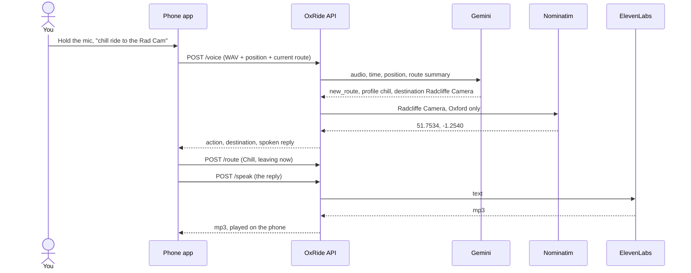

**Gemini.** The phone records the mic (mp4 on iPhones, webm elsewhere), converts it to 16 kHz mono WAV in the browser and sends it to `/voice`. Gemini hears the audio itself, together with the time, your position and a summary of the current route. It answers in structured JSON with one of three actions: a new route, a different way to the same place, or a spoken answer. The prompt carries 72 spoken names for 48 Oxford places, so "Univ", "Maudlin", "the House", "the Bod", "the JR", "Teddy Hall" and "Catz" all land in the right place, and Gemini also returns what it heard so a mishearing shows on screen. The named place is then found with Nominatim inside the Oxford box. If the main model is slow or out of quota, two backup models get 10 s each.

**ElevenLabs.** Replies and directions are spoken with the `eleven_flash_v2_5` model, chosen for low latency. Pressing the mic stops the app mid-sentence so it never records its own voice, and the recorder lets go of the microphone after each recording because an open mic on an iPhone moves playback to the quiet earpiece. If ElevenLabs fails, the phone's built-in voice reads the same sentence.

</details>

<details>
<summary><b>Tiger Data: learning from real rides</b></summary>

<br>

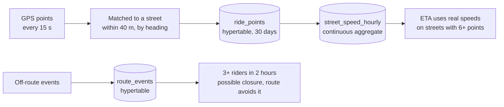

A ride starts when you plan a route (rerouting continues the same ride) and ends on arrival, on exit or when the page closes. Rides are anonymous: a random ride id, no account. Speeds are only measured between points 0.5 to 60 s apart with GPS accuracy of 40 m or better, and anything over 15 m/s is treated as a GPS jump. Rides from the simulator on `/debug` are stored as simulated and never feed learning.

Tiger Data maintains the hourly speed per street itself:

```sql
CREATE MATERIALIZED VIEW street_speed_hourly
  WITH (timescaledb.continuous, timescaledb.materialized_only = false) AS
  SELECT time_bucket('1 hour', time) AS bucket, edge_u, edge_v, simulated,
         avg(speed_ms) AS avg_speed, count(*) AS points
  FROM ride_points WHERE speed_ms IS NOT NULL
  GROUP BY 1, 2, 3, 4 WITH NO DATA;

-- refreshed every 10 minutes; raw GPS points are dropped after 30 days, the hourly speeds stay
SELECT add_continuous_aggregate_policy('street_speed_hourly',
  start_offset => INTERVAL '30 days', end_offset => INTERVAL '1 hour',
  schedule_interval => INTERVAL '10 minutes');
SELECT add_retention_policy('ride_points', INTERVAL '30 days');
```

`materialized_only = false` means a ride counts as soon as its points arrive, before the next refresh. Every database call is wrapped so that with no database, or a broken one, routing works exactly as before.

</details>

<details>
<summary><b>When to leave</b></summary>

<br>

When you're leaving now, OxRide reads the cached hourly forecast at now, +15, +30, +45 and +60 minutes and at your arrival time, and shows at most one line, only if waiting (or hurrying) is worth it. In order of priority:

1. **Rain about to start:** *"Rain from about 14:00. Leave now to arrive dry."*
2. **Rain about to stop:** *"Rain should stop by about 13:00. Leave then to stay dry."*
3. **Sunset or sunrise soon:** *"Sunset at 16:45. Leave within 12 min to arrive before dark."*
4. **Icy roads** (2 °C or colder, warming within the hour).
5. **Rush hour about to end:** *"Rush hour ends at 09:30: quieter roads if you leave then."*

Rain counts as likely from a 50% chance, and as gone below 20%, so the hint doesn't flip-flop on a borderline forecast. Sunrise and sunset are computed with NOAA's solar formula, no network needed.

</details>

<details>
<summary><b>The /debug page</b></summary>

<br>

[`/debug`](https://oxfordride.vercel.app/debug) shows every decision the router makes: the cost of each road segment broken into its parts, the junctions A* explored, our route against the shortest route, Google's cycling route (with a Google key) and a route you draw, sliders for every ride-type factor, weather scenarios (night, rush hour, rain, headwind), a simulated ride at up to 20× speed, live tests of each API key, and the Tiger Data numbers: rides, speed per street on the map, predicted vs actual times and trouble spots.

</details>

## Prize tracks

| Track | What we built for it |
| --- | --- |
| **Main theme: TIME** | The route itself changes with darkness, rush hour and rain, and a one-line hint says when to leave. |
| **HRT: Data for Predictions and Decision Making** | An ETA built from 2.2 million cleaned trips, a hand-written A* that turns it into route decisions, and real OxRide rides that replace estimates street by street. |
| **MLH: Gemini API** | Gemini hears the recorded voice and returns a structured action, with Oxford nicknames, context and backup models. |
| **MLH: ElevenLabs** | Every reply and every turn spoken with the low-latency flash model, with mute, interruption and a phone-voice fallback. |
| **MLH: Tiger Data** | Hypertables for GPS points and events, a continuous aggregate of speed per street per hour, and retention; it feeds the ETA and steers routes around possible closures. |
| **Hackathons UK: Hackiest Hack** | Our own A*, our own map of Oxford, our own directions and off-route check, and a WAV encoder written by hand so every phone sends Gemini the same audio. |

## Run it yourself

You need Python 3.12 and Node 24 (the frontend unit tests run TypeScript directly). The Oxford map (`backend/oxford_graph.pkl`) is already in the repo.

```bash
git clone https://github.com/OrionSilverStorm/OxRide.git
cd OxRide

# backend
python3 -m venv .venv
.venv/bin/pip install -r backend/requirements-dev.txt
cp .env.example backend/.env        # add keys; every one is optional

# frontend + backend together
cd frontend
npm install
npm run dev                          # app on http://localhost:3000, API on :8000
```

Open http://localhost:3000, and http://localhost:3000/debug for the routing tools. Browsers only give GPS and the microphone to `localhost` or HTTPS, so to try it on a phone use the [live site](https://oxfordride.vercel.app) or an HTTPS tunnel.

| Variable | What it turns on |
| --- | --- |
| `GEMINI_API_KEY`, `GEMINI_MODEL`, `GEMINI_FALLBACK_MODELS` | Voice commands |
| `ELEVENLABS_API_KEY`, `ELEVENLABS_VOICE_ID`, `ELEVENLABS_MODEL` | The spoken voice (without it, the phone's own voice speaks) |
| `DATABASE_URL` | The Tiger Data ride log, learned speeds and trouble spots |
| `GOOGLE_MAPS_API_KEY` | Google's route for comparison on `/debug` and in the benchmark |

To rebuild the map from OpenStreetMap (takes several minutes):

```bash
.venv/bin/pip install -r backend/requirements-build.txt
cd backend && ../.venv/bin/python build_graph.py
```

**Tests.** `cd frontend && npm test` runs the backend tests (pytest, no network: weather comes from a saved forecast), the frontend unit tests and the type check. GitHub Actions runs the same on every push, plus a production build.

## Project layout

```
backend/
  build_graph.py     one-off: OpenStreetMap + elevation -> oxford_graph.pkl
  routing.py         A*, edge cost, ride types
  navigation.py      turn-by-turn steps
  time_model.py      weather, time of day, speed model, ETA, when to leave
  ai.py              Gemini, ElevenLabs, Nominatim
  ridelog.py, db.py  Tiger Data ride log
  main.py            API endpoints
  debug.py           /debug endpoints
  benchmark.py       ours vs shortest vs Google on fixed trips
  tests/             pytest
frontend/
  components/Map.tsx the rider screen: map, search, navigation, voice
  hooks/             useVoice, useRideLog, useTheme
  lib/               api client, route maths, speech, recording, WAV encoding
  app/debug/         the routing debug page
```

## Limitations

- Oxford only: the map and the place search stop at the city's edge.
- The app plans for leaving now. The API already accepts a departure time (`depart_at`), but there is no picker yet.
- Keep the screen on while riding: phones pause GPS when locked, and there is no screen wake lock yet.
- Rush hour is a fixed weekday clock window, not live traffic.

## Team

Built at **OxHack 2026** by Angel Boateng, Louis Smith, Maksym Shevchenko and Shiven Kothari.

## Credits

- Map data © [OpenStreetMap](https://www.openstreetmap.org/copyright) contributors, loaded with [OSMnx](https://github.com/gboeing/osmnx)
- Elevation: SRTM via [OpenTopoData](https://www.opentopodata.org)
- Weather: [Open-Meteo](https://open-meteo.com)
- Place search: [Nominatim](https://nominatim.org); search suggestions: [Photon](https://photon.komoot.io) by Komoot
- Speed effects: the *Bicycle Driving Behaviour in Germany* dataset
- Colours: [Everforest](https://github.com/sainnhe/everforest)
